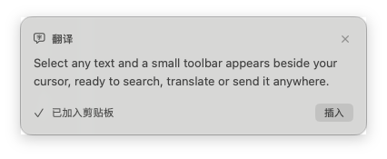
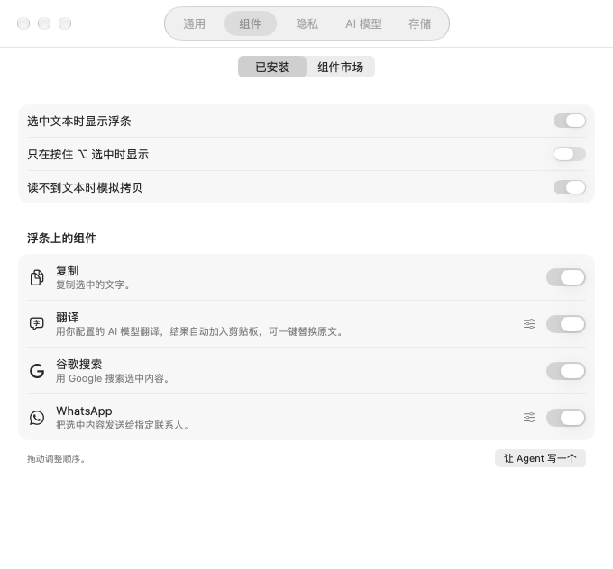
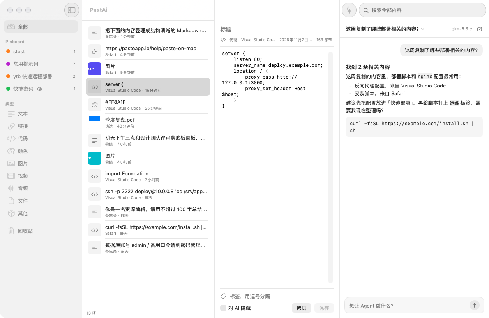

<div align="center">

# PastAi

**macOS 上的 AI 剪贴板管理器和划词工具条**

记录所有格式的剪贴板历史，在任意选中的文字上弹出 PopClip 式工具条，还有一个能搜索、整理和编辑你所有复制内容的 AI Agent。

[English](README.md) | [简体中文](README.zh-CN.md)

[](https://github.com/skingko/PastAi/releases/latest)


</div>

## 它能做什么

PastAi 是一款原生 Mac 剪贴板管理器，类似 Paste；同时带有类似 PopClip 的划词工具条，两者都接入了 AI Agent。它用 Swift 和系统框架编写，没有任何第三方依赖，下载只有约 2MB，你复制的内容不会经过任何第三方代码。

| | |
|---|---|
| **剪贴板历史** | 文本、富文本、图片、视频、音频、文件和应用私有格式，粘贴时原样还原 |
| **划词工具条** | 在任意应用中选中文字，光标旁立即出现小工具条 |
| **组件市场** | 内置 30 个组件，覆盖搜索、购物、社交、地图和 AI，兼顾中美常用服务 |
| **AI Agent** | 接入你自己的模型，搜索、打标签、合并、改写和清理资料库 |
| **高速搜索** | 全文搜索，完整支持中文，图片里的文字也能搜到 |
| **隐私优先** | 本地存储，可按 Pinboard 控制 AI 可见性，Agent 改动内容前必须经你确认 |

## 下载

在 [Releases](https://github.com/skingko/PastAi/releases/latest) 下载最新的公证版本，打开 DMG，把 PastAi 拖到"应用程序"。

需要 macOS 26 或更高版本，以及 Apple 芯片的 Mac。

PastAi 常驻菜单栏。首次使用时会申请**辅助功能**权限，用于读取选中的文字和向其他应用粘贴。这个权限不是必需的：没有它，历史和搜索照常工作，粘贴会退回为写入剪贴板。

## 剪贴板面板

按 `⇧⌘V`，面板从屏幕最底部滑出并覆盖程序坞，同时不会抢走当前应用的焦点。

| 按键 | 作用 |
|---|---|
| `⇧⌘V` | 打开或关闭面板（可自定义） |
| `←` `→` | 切换卡片，按住 `⇧` 多选 |
| `↩` / `⇧↩` | 粘贴 / 粘贴为纯文本 |
| `⌘1` 到 `⌘9` | 粘贴第 N 张卡片 |
| 空格 | Quick Look 预览 |
| 直接打字 | 搜索 |
| `⌘F` | 按类型、来源应用和日期筛选 |
| `⌘←` `⌘→` 或 `⌘[` `⌘]` | 切换标签页 |
| `⌘E` / `⌘R` | 编辑 / 重命名 |
| `⌘N` | 新建文本 |
| `⌘J` | 把选中内容交给 Agent |
| `⌘T` | 暂停记录 |
| `⌘⌫` | 删除 |
| `Esc` | 清空搜索，再按一次关闭 |

**Pinboard** 用来保存重要内容，永不过期。你也可以在设置里把图片、链接等默认分类固定为标签页。密码管理器的内容会被自动跳过，也可以排除任意应用。

## 划词工具条

在任意应用中拖动或双击选中文字，光标旁就会出现工具条。


默认启用四个组件：

- **复制**
- **翻译**：调用你配置的 AI 模型，在小弹窗里流式显示。译文自动加入剪贴板，可以随处粘贴，也可以点**插入**直接替换原文。
- **谷歌搜索**
- **WhatsApp**：把选中内容发给你指定的联系人，也可以设置为自动发送。



工具条永远不抢焦点，所以"插入"才能直接替换选区。组件只在适用时出现：打开链接只在选中网址时显示，粘贴只在可编辑文本中显示。

## 组件

打开**设置 › 组件**，可以调整工具条顺序、配置每个组件、浏览市场。市场就是本仓库的 [`extensions`](extensions) 目录，直接从 GitHub 获取，app 内也带有一份副本，离线同样可用。



| 分类 | 组件 |
|---|---|
| 文本 | 复制、粘贴、大小写转换、字数统计、打开链接 |
| AI | 翻译、总结、润色、解释、ChatGPT |
| 美国常用 | Google、Google 地图、维基百科、YouTube、亚马逊、Reddit、X、GitHub、WhatsApp、Gmail |
| 中国常用 | 百度、知乎、微博、哔哩哔哩、淘宝、京东、小红书、豆瓣、高德地图、微信 |

所有组件使用统一的清单格式，支持六种动作：打开网址或应用链接、启动应用、复制、粘贴、运行沙箱 JavaScript、调用 AI 模型。自己编写组件请看 [docs/EXTENSIONS.md](docs/EXTENSIONS.md)。

**也可以直接让 Agent 写。** 描述你想要的功能，比如"加一个把网址转成 Markdown 链接的按钮"，Agent 会写好组件，用样例文本试运行，经你确认后安装。

组件特意不支持 Shell 和 AppleScript。组件是下载来的代码，所以只能打开链接和应用、调用你的模型，或者在没有网络和文件权限的 JavaScript 沙箱里计算。每个脚本都在独立进程中运行，卡死会被直接终止。

## AI Agent



打开主窗口，直接说你想做什么：

- "把这周复制的链接按主题分到 Pinboard"
- "找出上个月复制的 nginx 配置"
- "把这五段内容合并成整洁的 Markdown"
- "把这张截图里的表格转成 CSV"
- "清理重复项和旧截图"

在**设置 › AI 模型**里添加服务。PastAi 支持 OpenAI 兼容协议，覆盖 OpenAI、Google Gemini、DeepSeek、通义千问、Kimi、智谱 GLM、OpenRouter、Ollama 和 LM Studio，也支持 Anthropic 原生接口。API Key 保存在 macOS 钥匙串里。

使用 Ollama 或 LM Studio 时，内容不会离开你的 Mac。

> 智谱 Coding Plan 等套餐通常限定在官方支持的工具里使用，在 PastAi 中建议使用按量计费的 API Key。

## 隐私与安全

下面这些规则由代码强制执行，而不是靠提示词约束模型：

- **默认本地。** 资料库保存在 `~/Library/Application Support/PastAi`。
- **隐藏就是真的隐藏。** 对 AI 隐藏的条目或 Pinboard 在数据库查询层就被过滤，Agent 即使知道 ID 也读不到。疑似密钥的内容会自动隐藏。
- **审批。** 读取自动进行；修改、删除内容和安装组件每次都需要你确认，"本次对话都允许"也不覆盖这些操作。
- **撤销。** Agent 一次运行的所有改动都可以一键撤销。
- **剪贴板内容只是数据。** 复制的内容无法指挥 Agent，而且 Agent 没有联网、文件或 Shell 工具，内容只会发给你配置的模型。
- **知情同意。** 内容第一次要发送到云端服务时，PastAi 会先询问你。

## 从源码构建

只需要 Xcode 命令行工具。

```bash
git clone https://github.com/skingko/PastAi.git
cd PastAi
./scripts/build.sh debug     # 或 release
swift test
```

构建结果在 `~/Library/Caches/PastAi/dist/PastAi.app`。钥匙串里有 Developer ID 证书时会自动签名，否则使用临时签名，每次构建后 macOS 都会重新询问辅助功能权限。

`scripts/release.sh` 会在 `dist/` 生成已签名并公证的 DMG。

### 架构

```text
App/                 组合根：菜单栏、快捷键、生命周期
Sources/
  ClipCore/          采集、存储、搜索、粘贴。无 UI，无 AI
  ClipEnrich/        缩略图、媒体元数据、OCR
  ClipExtensions/    组件清单、校验、JavaScript 沙箱、市场
  QuickPanel/        剪贴板面板
  SelectionBar/      划词工具条和结果弹窗
  ClipAgent/         模型客户端、工具、审批、Agent 循环
  Workspace/         主窗口、聊天和设置
extensions/          组件市场
```

`QuickPanel` 和 `SelectionBar` 不链接任何 AI 代码，模型配置出错也不影响复制粘贴。资料库的所有修改都走同一条路径和同一份撤销日志，人和 Agent 都一样。

## 参与贡献

贡献组件是最简单的方式：在 [`extensions`](extensions) 下新建文件夹，运行 `python3 scripts/build-extension-index.py`，然后提交 Pull Request。合并后所有人的市场里都会出现。

---

Mac 剪贴板管理器、Paste 替代品、PopClip 替代品、macOS 划词工具、划词翻译、剪贴板历史、图片文字搜索、macOS AI Agent、本地大模型剪贴板工具。
